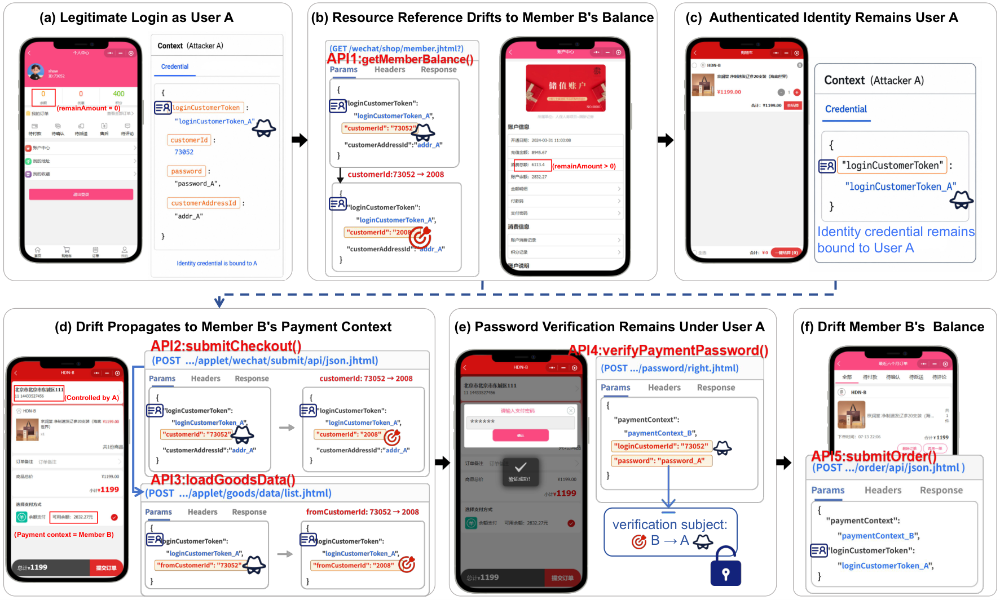
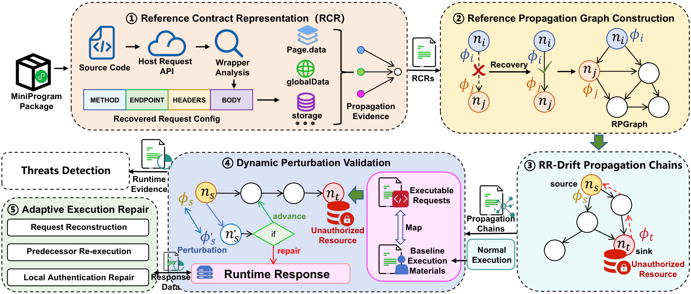

# MiniDrifter: Detecting Propagation Threats of Resource-Reference Drift in Mini Programs

## Abstract

Mini programs are widely deployed in super-app ecosystems, where business functionalities are commonly implemented through chained API workflows. In such workflows, authenticated identities and resource references, i.e., identifiers for selection of target resources, are propagated across multiple dependent requests. This execution model introduces a practical workflow-level security risk, in which a resource reference may drift away from the scope of the authenticated identity and continue to propagate through downstream APIs. This phenomenon, referred to as RR-Drift, becomes security critical when it reaches sensitive operations and causes real security consequences.

Detecting such RR-Drift propagation threats is challenging due to complex propagation dependency and highly constrained nature of drift values. This work presents the first systematic study of RR-Drift propagation threats in mini programs. We formalize this novel threat and propose a hybrid detection framework, *MiniDrifter*, that combines static backward reference taint analysis with dynamic perturbation validation. MiniDrifter recovers candidate propagation chains, perturbs drift-capable source references, and validates whether the propagated drift can reach real sensitive sinks.

Evaluation on an annotated benchmark confirms the high effectiveness of MiniDrifter, which substantially outperforms state-of-the-art baselines. At scale, MiniDrifter detects over 31k RR-Drift propagation threats in more than 41k real-world mini-programs, demonstrating the prevalence of such threats in practice. Among them, 11 representative threats have been formally acknowledged by official vulnerability-reporting platforms such as CNVD and Butian. Additional cross-platform experiments show that such threats persist widely across major super-app platforms, and that MiniDrifter transfers effectively after lightweight platform-aware adaptation.

---

## Motivation

<p align="center">
  
</p>
<p align="center"><em>Figure 1.</em> A representative RR-Drift propagation threat in a shopping mini-program workflow (<code>mini_x</code>). [<a href="Fig/Fig1.pdf">PDF</a>]</p>

Figure 1 illustrates a representative case of *resource reference drift* (RR-Drift) and its threats across a business workflow in a shopping mini program operated by a leading restaurant chain in China, which we anonymize as `mini_x` for responsible disclosure.

As a shopping mini program, `mini_x` supports a complete balance-payment workflow consisting of multiple dependent steps, including membership-balance query, checkout initialization, payment-password verification, order creation, and balance deduction.

**Step 1: Drift originates at an upstream resource query.**  
As shown in Figure 1(a), User A (`user_A`) logs in with a legitimate account and retains the authenticated credential `loginCustomerToken`. Ideally, this credential should only authorize access to resources associated with `user_A`. However, in `mini_x`, the queried member resource is not tightly anchored to the authenticated identity. By replacing the `customerId` parameter in the balance-query request, `user_A` causes the resource reference to drift away from the original identity context. As a result, `user_A` can invoke the API `getMemberBalance()` to retrieve the balance information of another member without authorization, thereby identifying Member B (`mem_B`) as a target with available funds, as shown in Figure 1(b).

**Step 2: The drift propagates into a downstream payment context.**  
The impact of this drift is further propagated and escalated as the workflow proceeds. Still under the same authenticated session, `user_A` selects products and enters the checkout phase (Figure 1(c)). During checkout initialization and product-data confirmation, the backend invokes a sequence of business APIs, including `submitCheckout()` and `loadGoodsData()`, which accept resource-related parameters such as `customerId` and `fromCustomerId`. By deliberately substituting the resource identifiers of `mem_B` to these APIs, `user_A` is able to enter a payment context associated with `mem_B`, as illustrated in Figure 1(d).

**Step 3: The drift culminates in sensitive balance payment.**  
At the most critical stage of payment-password verification, `user_A` continues to operate under the original authenticated session and successfully passes `verifyPaymentPassword()` using `user_A`'s own account password. However, because the payment context has already drifted to `mem_B`, the subsequent order submission through `submitOrder()` is completed against `mem_B`'s balance rather than `user_A`'s via the propagation of `customerId`, as shown in Figure 1(e)–(f). In other words, the system validates the payer's identity using `user_A`'s credential, but charges the payment to `mem_B`'s account balance, resulting in a serious asset-loss vulnerability (disclosed to the Butian vulnerability database and rated as **high-risk**, No. QTVA-2026-10738721).

---

## Approach

<p align="center">
  
</p>
<p align="center"><em>Figure 3.</em> Overview of <em>MiniDrifter</em>: static drift-oriented taint analysis and dynamic perturbation validation. [<a href="Fig/Fig3.pdf">PDF</a>]</p>

From the four conditions defined in the problem formulation, the detection of RR-Drift propagation threats can be naturally formulated as a taint-oriented reachability problem. In particular, the drifted resource reference serves as the *source*, while the sensitive-risk resource reference serves as the *sink*. The key question is whether there exists a cross-API reference dependency chain that propagates a drifted reference from the source to the sink within the workflow.

As shown in Figure 3, we design and implement **MiniDrifter**, the first hybrid framework for detecting RR-Drift propagation threats in mini programs. MiniDrifter consists of two tightly coupled components: a *static drift-oriented taint analyzer* and a *dynamic perturbation validator*, which are designed to address the challenges of complex propagation dependencies and uncertain drift values, respectively.

The static taint analyzer first extracts resource-reference-related request information and organizes it into a structured representation (**RCR**, step ①). Based on the extracted representation nodes and their dependency relations, it then constructs a global propagation graph for resource references in the target mini program (**RPGraph**, step ②). On top of the constructed graph, MiniDrifter further identifies sensitive reference-related nodes and performs backward drift-oriented taint analysis to recover candidate risky RR-Drift propagation chains (step ③), which are then passed to the dynamic component for further validation.

The dynamic perturbation validator takes the candidate RR-Drift propagation chains as input. It first performs normal executions to collect baseline execution materials and maps them to the requests along each chain, and then perturbs the source reference and observes the resulting runtime responses and sensitive threat effects (step ④). If the execution fails, MiniDrifter further applies different adaptive repair strategies according to the failure responses (step ⑤), so as to support continued validation execution.

---

## Repository Structure

```text
minidrifter-artifact/
├── Fig/                 # Paper figures used in this README
│   ├── Fig1.pdf / .png  # Motivation case (RR-Drift workflow)
│   └── Fig3.pdf / .png  # MiniDrifter approach overview
├── Data/                # Experiment artifacts (RQ1 / RQ2 / RQ4 / PoC)
├── MiniCollector/       # Collection & package reverse-analysis (Windows)
└── MiniDrifter/         # Hybrid RR-Drift detection framework (Linux)
```

| Path | Role |
|------|------|
| [`Data/`](Data/) | Evaluation data: RQ1 sample-level results, RQ2 full-scale corpus tables, RQ4 cross-platform results, PoC materials, and **official vulnerability acknowledgments** (CNVD / Butian / Vulbox certificates). Large source packages are provided via [Release](https://github.com/PeaceWorker03/minidrifter-artifact/releases/tag/data-sources-v1). |
| [`MiniCollector/`](MiniCollector/) | Automated mini-program **collection** via UI-control localization on PC WeChat, package capture, WeDecode unpacking, and category classification. |
| [`MiniDrifter/`](MiniDrifter/) | Hybrid **detection** framework: static RCR → RPGraph → RR-Drift chains, plus dynamic perturbation validation. |

Public identifiers in `Data/` are anonymized. Do not expect real WeChat appids, backend URLs, tokens, or exploit payloads in the published CSVs.

---

## MiniCollector

**Purpose.** Collect real-world WeChat mini programs at scale by driving the PC WeChat client through UI-control localization, capture local code packages, unpack them with WeDecode, and classify recovered apps into the service strata used in RQ2.

### Runtime environment

| Item | Spec |
|------|------|
| OS | **Windows 11** (collection host) |
| CPU | Intel Core i9-14900KF (24 cores / 32 threads) |
| Memory | 32 GB |
| Client | WeChat **Windows** desktop (logged-in session required) |
| Language | Python 3.10+ (3.12 recommended) |
| Node | Node.js 18+ (`wedecode` CLI) |

> Paper wording: *The collection and package-reversing framework runs on a Windows 11 host equipped with an Intel Core i9-14900KF CPU (24 cores / 32 threads) and 32 GB of memory.*

### Deployment requirements

1. **Windows host** with a graphical desktop session (UI automation needs the interactive WeChat window).
2. **WeChat for Windows** installed and **logged in**; the mini-program panel must be reachable.
3. **Python** virtual environment with UI automation dependencies.
4. **WeDecode** available on `PATH` (or set `wedecode_cmd` in `config.json`).
5. Writable `data_root` for `_raw` / category archives / `_reports` (see `config.example.json`).

### Install

```bat
cd MiniCollector
python -m venv .venv
.venv\Scripts\activate
pip install -r requirements.txt

npm install -g wedecode
copy config.example.json config.json
:: edit config.json: data_root, wedecode_cmd, workers
```

### Run

```bat
:: UI-control collection (PC WeChat must be in foreground / reachable)
python open_miniprograms_ui.py

:: Unpack + identify + classify packages discovered in the WeChat cache
python pipeline.py --workers 8
```

| Script | Role |
|--------|------|
| `open_miniprograms_ui.py` | Search / click mini-program UI controls and load apps into the local cache |
| `launch_miniprograms.py` | Optional URL-Scheme launcher to refresh caches |
| `pipeline.py` | Discover packages → WeDecode unpack → identify → classify → archive |
| `discover.py` / `identify.py` / `classify.py` | Cache discovery, naming, and category assignment |

Emergency stop for UI collection: move the mouse to the **top-left corner** of the screen (PyAutoGUI failsafe).

---

## MiniDrifter

**Purpose.** Detect RR-Drift propagation threats: recover candidate chains statically, then validate by perturbing drift-capable source references and observing whether sensitive sinks are reached.

### Runtime environment

| Item | Spec |
|------|------|
| OS | **Ubuntu 24.04 LTS** |
| CPU | 24-core |
| Memory | 64 GB |
| Python | **3.12.5** |
| Parallelism | **8** worker processes |

> Paper wording: *The MiniDrifter framework runs on an Ubuntu 24.04 LTS server with a 24-core CPU, 64 GB of memory, and Python 3.12.5, using eight parallel worker processes.*

### Deployment requirements

1. **Linux server** (Ubuntu 24.04 LTS recommended) with Python **3.12.5**.
2. Build tools for native wheels if needed (`build-essential`).
3. Unpacked mini-program source trees as analysis input (from MiniCollector / `Data` releases).
4. Optional: Node.js for `tools/jsparser` (JS call-site helper).
5. For **dynamic** validation: runtime materials / session context for the target app (platform-dependent); static `analyze` / `paper-static` can run without live login.

Supported `--platform` values include `wechat`, `qq`, `alipay`, `douyin`, and `baidu` (lightweight platform-aware adaptation for RQ4).

### Install

```bash
# Ubuntu 24.04 LTS
sudo apt update
sudo apt install -y python3.12 python3.12-venv python3-pip build-essential

cd MiniDrifter
python3.12 -m venv .venv
source .venv/bin/activate
pip install -U pip
pip install -e .

# optional
cd tools/jsparser && npm install && cd ../..
```

### Run

```bash
source .venv/bin/activate

# Full static analysis on an unpacked mini program
python -m minidrifter.cli analyze \
  --input /path/to/unpacked-miniapp \
  --output /path/to/OUTPUT \
  --platform wechat

# Rebuild RCR / RPGraph / RR-Drift chains on an existing OUTPUT pack
python -m minidrifter.cli paper-static -i /path/to/OUTPUT
```

### Main outputs under `OUTPUT/`

After analysis, MiniDrifter writes intermediate and final results into the output directory, including:

| File | Description |
|------|-------------|
| `rcr_pack.json` | Per-request reference contracts recovered from the mini program |
| `rpgraph.json` | Reference propagation graph over API / reference nodes and edges |
| `rrdrift_propagation_chains.json` | Candidate RR-Drift chains from drift sources to sensitive sinks |
| `workflows.json` | Convenience export of the same chain set |
| `drift_plans.json` | Plans used by the dynamic validator to perturb source references |

See [`MiniDrifter/README.md`](MiniDrifter/README.md) for CLI details and more options.

---

## Data Artifacts

See [`Data/README.md`](Data/README.md) for folder-level descriptions.

| Subfolder | Experiment |
|-----------|------------|
| `Data/419mintesapp/` | RQ1: 419-app sample-level detection results |
| `Data/FullScaleCorpus/` | RQ2: 41,362-program / 31,842-threat tables |
| `Data/CrossPlatformTransfer/` | RQ4: matching, manual reconfirmation, detection |
| `Data/Proof of Concept/` | Representative PoC materials **and received vulnerability acknowledgments** (CNVD / Butian QTVA / Vulbox certificate screenshots) |

Acknowledgment IDs currently included under `Data/Proof of Concept/` include CNVD-2026-25520, CNVD-2026-32955, CNVD-2026-36635, CNVD-2026-36806, CNVD-2026-36815, CNVD-2026-36844, CNVD-2026-36915, QTVA-2026-10738721, QTVA-2026-10766072, QTVA-2026-10766087, and vulbox-2026-03573200.

RQ1 unpacked sources (`419mintesapp_source.zip`, ~1.4 GB) are **not** stored in git; download from:

https://github.com/PeaceWorker03/minidrifter-artifact/releases/tag/data-sources-v1

---

## Citation

If you use this artifact, please cite the corresponding paper:

**MiniDrifter: Detecting Propagation Threats of Resource-Reference Drift in Mini Programs.**

---

## Responsible Disclosure

Experiment tables are anonymized. Real application names, appids, tokens, full backend URLs, and ready-to-use exploit payloads are intentionally withheld from the public artifact. Representative confirmed cases were reported through official channels (e.g., CNVD / Butian).
